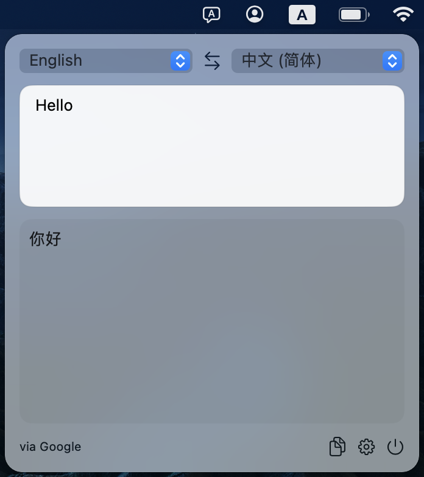

# iTranslator

一款简洁的 macOS 菜单栏翻译工具，支持英语与简体中文互译。输入文字后自动翻译，可一键复制结果。



## 功能

- 支持 Google 翻译、Apple 翻译和 OpenAI 兼容的 LLM 接口。
- 可调整翻译服务的尝试顺序，并按需启用或停用。
- 支持交换源语言与目标语言。

## 安装

需要 Apple 芯片 Mac、macOS 15 或更高版本，以及 Xcode 命令行工具。在仓库目录运行：

```bash
./install.sh
```

脚本会构建应用并安装到 `~/Applications/iTranslator.app`。打开应用后，点击菜单栏中的翻译图标即可使用。

## 设置

点击窗口底部的齿轮图标，可调整翻译服务顺序。使用 LLM 翻译时，填写 OpenAI 兼容服务的 Base URL、API Key 和模型名称。首次使用 Apple 翻译时，系统可能提示下载语言包。
